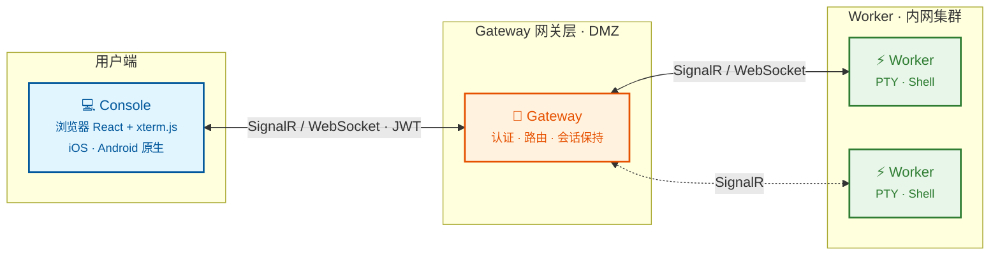
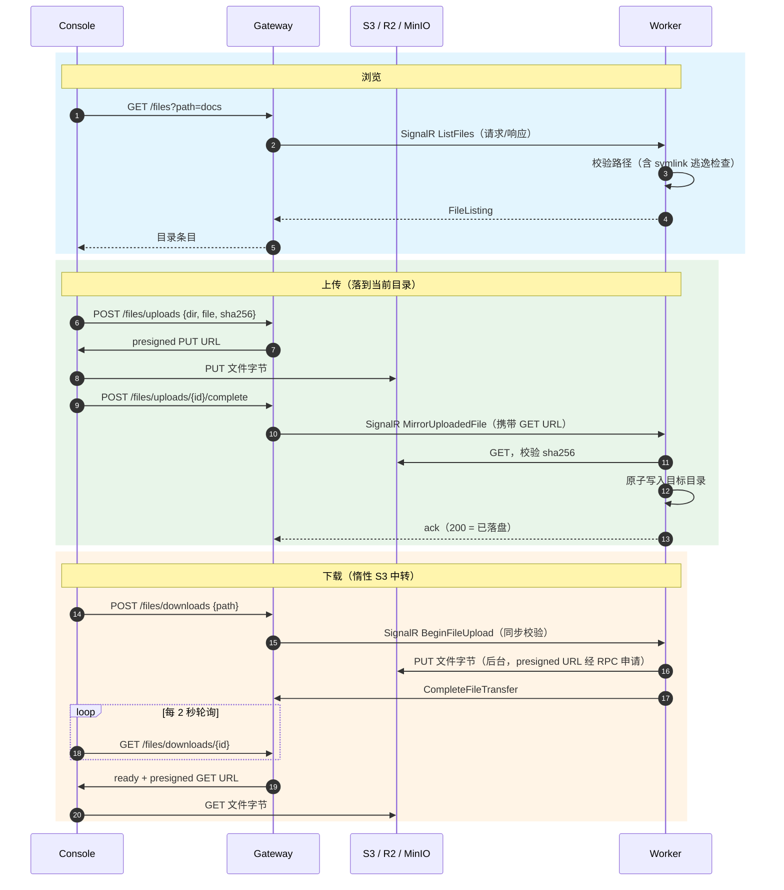

# Corterm

**远程终端，触手可及。**

[English](README.md)

[](https://github.com/monster-echo/CortexTerminal2/actions/workflows/ci.yml)
[](https://github.com/monster-echo/CortexTerminal2/pkgs/container/corterm-gateway)
[](https://github.com/monster-echo/CortexTerminal2/releases)

Corterm 是一个远程终端平台。在任意机器上安装轻量级 Worker，部署 Gateway，即可通过浏览器或手机访问终端——关掉页面，Shell 依然在后台运行。

## 架构



- **Gateway** -- 中心服务器，负责认证、会话路由和实时通信。
- **Worker** -- 轻量级代理，运行在被管理机器上，负责 PTY 会话管理和 I/O 流转发。
- **Console** -- 浏览器终端界面，同时提供 iOS 和 Android 原生客户端。
  > [!WARNING]
  > 浏览器版 Console（`src/Gateway/CortexTerminal.Console`）**已停止维护**，请使用 Flutter（iOS / Android）或 HarmonyOS 客户端。

## 功能

- **浏览器原生终端** -- 基于 xterm.js + WebGL 渲染的完整终端，桌面、平板、手机通用。
- **会话持久化** -- 随时断开和重连，Shell 持续运行，重连时自动回放历史输出。
- **多机管理** -- 单个 Gateway 连接和管理任意数量的远程机器。
- **移动端支持** -- iOS / Android 原生应用，内置终端虚拟键盘、触觉反馈和自适应布局。
- **AI Agent 追踪** -- 实时查看 Claude Code 的工作过程。Claude Code hooks 把每次 prompt、工具调用和通知上报到 Worker，Console 渲染为结构化时间线，让你能监控任意 Worker 上跑着的 agent。
- **文件传输** -- Console 与 Worker 之间的双向文件交换，基于 S3 兼容存储。Console 投递的文件会立即落到 shell 工作目录；写入 `$CORTERM_ARTIFACTS_DIR` 的文件会以气泡形式出现，按需下载。
- **资源监控** -- 每个 Worker 的实时 CPU / 内存占用，加上客户端到 Worker 的延迟探测。
- **多种登录方式** -- 密码、手机短信、GitHub OAuth、Google OAuth、Apple Sign-In。
- **Worker 管理** -- 监控状态、远程升级、诊断检查（`corterm doctor`）。
- **管理后台** -- 用户管理、邀请、角色权限、审计日志。

## 快速开始

### 1. 部署 Gateway

```bash
docker run -p 5045:5045 ghcr.io/monster-echo/corterm-gateway:latest
```

### 2. 安装 Worker

**Linux / macOS：**

```bash
curl -fsSL https://corterm.rwecho.top/install.sh | sh
```

**Windows (PowerShell)：**

```powershell
powershell -Command "irm https://corterm.rwecho.top/install.ps1 | iex"
```

### 3. 打开浏览器

访问 `http://localhost:5045`，登录后即可开启终端会话。

## 平台支持

**Worker：** Linux (amd64 / arm64) · macOS (Apple Silicon) · Windows x64 · Docker

**客户端：** 任意现代浏览器 · iOS · Android

### 移动端下载

<table>
  <tr>
    <td align="center">
      <a href="https://apps.apple.com/us/app/corterm/id6767838640">
        
      </a>
      <br/>App Store
    </td>
    <td align="center">
      <a href="https://play.google.com/store/apps/details?id=top.rwecho.cortexterminal">
        
      </a>
      <br/>Google Play
    </td>
    <td align="center">
      <a href="https://appgallery.huawei.com/app/detail?id=top.rwecho.cortexterminal">
        
      </a>
      <br/>华为应用市场
    </td>
    <td align="center">
      <a href="https://minio.myhome.rwecho.top:8443/minio/n8n-data/corterm/android/">
        
      </a>
      <br/>安卓 APK 下载
    </td>
  </tr>
</table>

## 技术栈

.NET 10 (Gateway / Worker) · React 19 + xterm.js (Console) · Flutter (Mobile · Worker UI) · ArkTS (HarmonyOS) · SignalR + MessagePack

## 运行测试

CI 在每次 push 时运行单元测试。本地运行：

```bash
dotnet test tests/Gateway/CortexTerminal.Gateway.Tests --configuration Release --filter "Category!=Integration"
dotnet test tests/Worker/CortexTerminal.Worker.Tests --configuration Release --filter "Category!=Integration"
```

S3 兼容存储集成测试为可选（标记为 `Category=Integration`）。本地启动 MinIO 后再运行筛选：

```bash
bash scripts/start-test-minio.sh
dotnet test tests/Gateway --filter "Category=Integration"
```

脚本默认使用 Podman（也支持 Docker），会创建独立于生产环境的 `corterm-artifacts-test` 桶。如需自定义凭据，通过 `CORTERM_TEST_S3_*` 环境变量覆盖。

## Roadmap

- [x] **文件传输** -- Console 与 Worker 之间通过 S3 presigned URL 双向传输（详见下文）
- [x] **Agent 事件追踪** -- Claude Code hooks 把每次 prompt、工具调用和通知上报到 Worker 并转发给 Console（旧的 `cortap` 包装 CLI 已退役，由 hooks 注入取代）
- [ ] **端口转发** -- 通过 Gateway 将本地端口隧道转发到远程机器
- [ ] **结构化输出** -- 将常见命令输出（`top`、`ps`、`docker ps`）渲染为可交互的卡片
- [ ] **多标签终端** -- 在单个浏览器标签页中打开多个会话
- [ ] **命令片段** -- 保存并复用常用命令

## 远程文件（文件夹管理）

手机端的「远程文件」页面是一个面向 Worker 会话根目录（即 PTY 工作目录，用户主目录）的只读文件夹管理器。不再向 shell 或 AI agent 注入任何 prompt、skill 或环境变量：文件就在 shell 工作的地方，agent 对传输完全无感。

**能力：**

- 浏览会话根目录的实时目录树（含 dotfile；指向根目录内部的软链可正常跟随）。
- 按需下载任意文件：点击时 Worker 才把文件推到 S3，手机再从 S3 拉取。
- 上传文件到当前浏览的目录：全程 sha256 校验，同名覆盖。

手机端不提供新建/重命名/删除 —— 文件管理请在终端里完成，一如既往。

**数据流：** Gateway 只负责签发 presigned URL 和传输状态，文件字节始终在 Console/Worker 与 S3 之间直连。传输有上限（默认单文件 50MB），中转对象会被自动回收。



**安全模型：** 手机发来的每个路径都会在 Worker 上校验 —— 必须解析在会话根目录内，且每一级 symlink 都追踪到最终目标（指向根外的软链会被拒绝）。传输请求按会话与用户双重鉴权；传输状态保存在 Gateway 内存中，Gateway 重启表现为可重试的 404，而不是陈旧状态。

### 配置

Gateway `appsettings.json`：

```json
"Storage": {
  "Endpoint": "https://s3.amazonaws.com",
  "Bucket": "corterm-artifacts",
  "Region": "us-east-1",
  "AccessKey": "...",
  "SecretKey": "...",
  "ForcePathStyle": false,
  "PresignedUrlTtl": "00:05:00"
},
"RemoteFiles": {
  "MaxTransferSizeBytes": 52428800,
  "PendingTransferTtl": "00:15:00",
  "ObjectRetention": "01:00:00",
  "CleanupInterval": "00:10:00"
}
```

本地 MinIO：

```bash
docker compose -f deploy/docker-compose.minio.yml up -d
```

然后把 `Storage:Endpoint` 指向 `http://localhost:9000` 并设置 `ForcePathStyle: true`。

### Worker 契约

Worker 负责路径安全与文件操作：列目录、镜像上传（`.downloading` 临时文件、sha256 校验、原子 rename）、经 Gateway 签发的 presigned URL 推送下载。**Worker 全程不持有 S3 凭证** —— 与 Console 完全对称。

## 许可证

[MIT](LICENSE)
